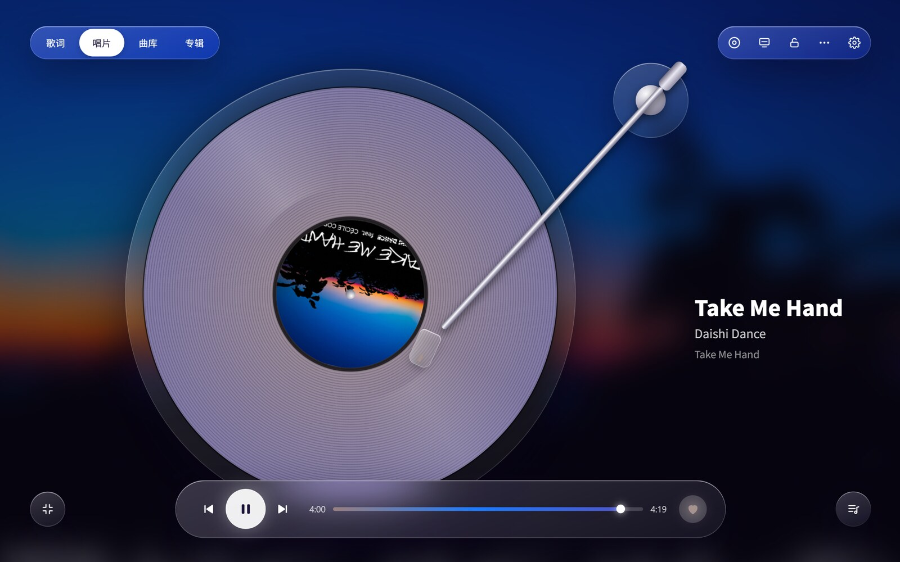
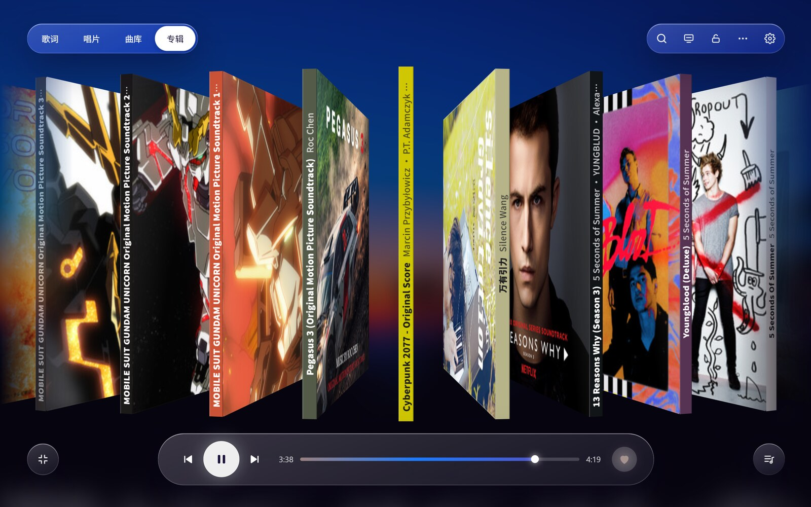
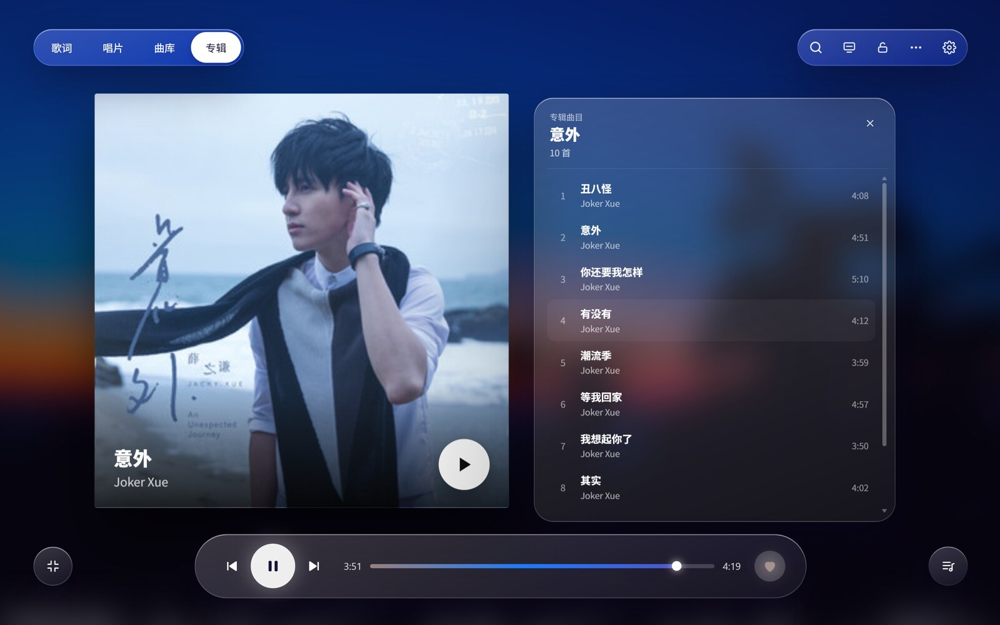

# ingfy

Windows 上的动态歌词软件，液态玻璃风格。读取电脑上正在播放的歌，显示全屏卡拉 OK 歌词、桌面歌词，以及跟着音乐跳动的拾音灯。

用 Tauri 2（Rust）+ React 写成。


| 唱片模式 | 专辑唱片架 | 展开专辑曲目 |
| --- | --- | --- |
|  |  |  |

---

## 目录

- [功能](#功能)
- [下载安装](#下载安装)
- [使用说明](#使用说明)
- [快捷键](#快捷键)
- [连接 Spotify](#连接-spotify)
- [常见问题](#常见问题)
- [从源码运行](#从源码运行)
- [打包与发布新版本](#打包与发布新版本)
- [项目结构](#项目结构)
- [致谢](#致谢)
- [许可证](#许可证)

---

## 功能

**全屏歌词**
- 逐字卡拉 OK：唱到的字依次填色、轻轻上浮，当前句放大变亮
- 网易云逐字歌词：有逐字时间的歌按每个字的真实起止时间填色
- 翻译：外语歌在每句下面显示一行翻译（可关）
- 罗马音：网易云歌词带罗马音时（日语歌常有），在原文下面显示（可关）
- 滚轮上下翻看整首歌词，点任意一句跳到那里
- 可以只显示歌词、只显示专辑封面和信息，或者两个都关、只留拾音灯
- 3 秒不动鼠标，上下栏自动收起；左下角一键无边框全屏
- 背景：专辑流体、纯色渐变、专辑封面放大，或者用自己的图片、视频

**唱片模式**
- 转动的黑胶唱片，唱臂按真实几何摆动，进度越往后唱针越靠近中间
- 单击唱针暂停，唱针抬起离开唱片；再点一下继续，唱针落回原位
- 拖唱针调整进度；左右推唱片换上一首 / 下一首
- 唱片外观可自定义：经典黑胶、彩胶、墨水飞溅、不规则斑点、双色拼接、漩涡渐变，或者每首随机

**曲库和专辑**
- 你的 Spotify 歌单（含"已点赞的歌曲"）和收藏的专辑，像唱片箱里竖着插的一排唱片
- 滚轮或拖动左右翻；点中间那张把它抽出来，右边展开所有歌名，点哪首播哪首
- 搜索：在自己的歌单 / 专辑里筛，或者搜整个 Spotify 曲库

**拾音灯**
- 采集电脑正在播放的声音，实时分析频谱，四种灯效：墨晕、直方图、圆环、声波（墨晕自带宣纸底的固定配色）
- 3D 模式：点顶栏的"3D"，镜头从原来的样子转过去——直方图变成立在镜面地上的一片光柱，圆环放平、圆心浮起一颗星球，声波变成水面上的光和倒影，墨晕立起一幅山水。歌词也飘进场景里：前三种只显示正在唱的这一句，横着铺开、每个字错落不齐；墨晕是竖排的书法，一个字一个字写出来。按住画面左右拖可以转镜头
- 颜色自动取自当前专辑封面，也可以自定义

**桌面歌词**
- 两行交错显示，悬浮在所有窗口上面，可以拖到任意位置
- 锁定后鼠标可以穿透，不挡下面的操作
- 颜色、背景透明度、罗马音、字号和全屏歌词分开设置

**其他**
- 右下角播放列表：正在播放的专辑 / 歌单里的所有歌
- 歌词时间微调（每首歌单独记住）、手动换一个歌词版本
- 分享歌词：选几句生成一张卡片，复制或保存
- 睡眠定时：15 / 30 / 60 分钟或本首播完后暂停
- 系统托盘、全局快捷键、开机自启、检查更新
- 灵动岛：屏幕顶部的歌词胶囊，可锁定穿透，也可展开控制播放、拖动位置
- 界面语言：简体中文 / English（默认跟随系统）
- 清理缓存：设置 → 通用 → 存储，显示缓存大小，一键清理（不影响设置和登录）

---

## 下载安装

1. 打开本仓库的 [Releases](../../releases) 页面，下载最新版本的 `ingfy_x.y.z_x64-setup.exe`。
2. 双击安装。默认装在当前用户下，不需要管理员权限。电脑上没有 WebView2 时，安装程序会自动下载。
3. 第一次运行时 Windows 可能弹出"Windows 已保护你的电脑"（安装包没有付费签名）。点 **更多信息 → 仍要运行** 即可。

**系统要求**：Windows 10 / 11（64 位）。

---

## 使用说明

1. 打开 ingfy，然后在 **Spotify、网易云音乐、QQ 音乐、浏览器** 等任意播放器里放一首歌。只要播放器支持 Windows 的媒体控件（按键盘上的音量键时会弹出歌曲信息的那种），ingfy 就能读到。
2. 顶部左边切换四个界面：**歌词 / 唱片 / 曲库 / 专辑**。
3. 顶部中间是拾音灯：最左边的圆形按钮开关灯，右边选灯效，"3D"开关立体模式，最右边两个按钮控制显示歌词 / 专辑信息。
4. 顶部右边依次是：桌面歌词开关、锁定桌面歌词、**⋯ 更多**（歌词时间微调、换歌词、分享、睡眠定时）、设置。
5. 底部是播放控制和进度条（可以拖动），右边的爱心是收藏到 Spotify。
6. 右下角按钮打开播放列表，左下角按钮进入全屏。

**关闭主窗口不会退出**：ingfy 会缩到屏幕右下角的托盘里，桌面歌词和快捷键继续工作。左键点托盘图标重新打开主窗口；右键菜单里可以退出。

**歌词对不上？**
- 整体快了或慢了：点 **⋯ → 歌词时间**，用 − / + 每次调 0.1 秒。
- 歌词版本不对（比如抓到了 Live 版）：点 **⋯ → 换一个歌词**，从候选里选一个。

这两项都会按歌曲记住，下次播放同一首自动生效。

---

## 快捷键

在任何程序里都能用：

下面是默认组合，都可以在 **设置 → 通用 → 快捷键** 里改：点按键帽，按下新组合即可，Delete 清空。

| 默认快捷键 | 作用 |
| --- | --- |
| `Ctrl` + `Alt` + `L` | 显示 / 隐藏桌面歌词 |
| `Ctrl` + `Alt` + `P` | 播放 / 暂停 |
| `Ctrl` + `Alt` + `←` / `→` | 上一首 / 下一首 |
| `Ctrl` + `Alt` + `K` | 收藏当前歌曲（需要连接 Spotify） |

如果某个组合已经被别的程序占用，ingfy 会跳过它并在设置里标出来，其他快捷键照常可用。

在全屏界面里：滚轮翻歌词、点歌词跳转、`Esc` 退出全屏 / 关闭面板。

---

## 连接 Spotify

歌词、拾音灯、桌面歌词这些**不需要**连接 Spotify，任何播放器都能用。连接 Spotify 后可以多用这些：

- 收藏 / 取消收藏正在播放的歌
- 曲库和专辑界面、右下角播放列表
- 点封面或歌名直接开始播放（**需要 Spotify Premium**，这是 Spotify 接口的限制）

连接方法：**设置 → Spotify → 连接 Spotify**，浏览器里同意授权后自动回到 ingfy。登录信息只保存在你自己电脑上。

**谁能登录**：ingfy 自带的 Spotify 应用处于 Spotify 的"开发模式"，只有被加进应用用户名单的账号能登录（Spotify 规定最多 5 人）。不在名单里的话，可以用自己的应用，不占名额，也不用改代码：

1. 打开 [Spotify 开发者后台](https://developer.spotify.com/dashboard)，用你的 Spotify 账号登录（需要 Premium）。
2. 点 **Create app**，名字随便填；Redirect URI 填 `http://127.0.0.1:43821/callback`；API 勾选 **Web API**，保存。
3. 在应用的 Settings 里复制 **Client ID**。
4. 回到 ingfy：**设置 → Spotify → 使用自己的 Client ID**，粘贴、保存，然后连接 Spotify。

设置里有同样的步骤和一键复制回调地址的按钮。不需要 Client Secret（用的是 PKCE 授权方式），也**不要**把 Client Secret 填到任何地方。

**半年重新连接一次**：Spotify 对开发模式应用的登录最长保留半年。到期后设置里会显示"登录已过期"，点"重新连接"即可。

---

## 常见问题

**打开后显示"没有在播放"**
确认播放器正在播放（不是暂停）。部分播放器需要在其设置里打开"在系统媒体控件中显示"。

**拾音灯不动**
拾音灯采集的是系统默认播放设备的声音。如果你用耳机或外接声卡，确认它被设为 Windows 的默认播放设备；切换设备后 ingfy 会自动重新连接。

**找不到歌词 / 歌词不对**
歌词先从网易云音乐找，找不到再用 LRCLIB。冷门歌曲可能两边都没有；歌词版本不对时用 **⋯ → 换一个歌词**。

**"上一首"只回到了这首的开头**
大多数播放器在一首歌播了几秒之后，按"上一首"只会回到开头，再按一次才是真正的上一首。这是播放器自己的行为。

**快捷键没反应**
可能和其他程序冲突了（比如某些输入法、显卡软件）。在那些程序里改掉冲突的组合即可。

**曲库里点播放提示需要 Premium**
从某张专辑或某个歌单开始播放，Spotify 只对 Premium 账号开放。浏览、搜索、收藏不需要 Premium。

---

## 从源码运行

**需要先安装：**
- [Rust](https://rustup.rs)（安装时选默认的 MSVC 工具链）
- Visual Studio 2022 的 **"使用 C++ 的桌面开发"** 工作负载（或单独的 Build Tools）
- [Node.js](https://nodejs.org) 20 以上，然后 `npm install -g pnpm`
- WebView2（Windows 10 / 11 一般自带）

**运行：**

```powershell
git clone https://github.com/Ingram5656/ingFY.git
cd ingFY
pnpm install
pnpm tauri dev
```

第一次要编译所有 Rust 依赖，需要几分钟，之后会快很多。如果 `pnpm install` 提示有依赖的构建脚本被忽略，运行一次 `pnpm approve-builds` 并允许 `esbuild`。

修改前端代码（`src/`）会自动刷新；修改 Rust（`src-tauri/`）或 `tauri.conf.json` 后需要停掉重新运行 `pnpm tauri dev`。

---

## 打包与发布新版本

### 打包

```powershell
pnpm tauri build
```

完成后：
- 安装程序：`src-tauri\target\release\bundle\nsis\ingfy_x.y.z_x64-setup.exe`
- 免安装程序：`src-tauri\target\release\ingfy.exe`

打包前先退出正在运行的 ingfy（包括托盘里的），否则会报"拒绝访问"：

```powershell
taskkill /IM ingfy.exe /F
```

### 发布新版本（让旧版本能收到更新提示）

1. 改版本号，三处保持一致：
   - `package.json` 的 `version`
   - `src-tauri/Cargo.toml` 的 `version`
   - `src-tauri/tauri.conf.json` 的 `version`
2. 在 `CHANGELOG.md` 里把"未发布"的内容整理到新版本下。
3. `pnpm tauri build` 打包。
4. 在 GitHub 上新建 Release：标签写 `v` 加版本号（例如 `v1.1.0`），把 `ingfy_x.y.z_x64-setup.exe` 拖进附件，说明可以直接复制 CHANGELOG 里这一版的内容。

旧版本启动时会读取仓库最新的 Release；发现版本号更高、并且附件里有 `.exe` 安装程序时，设置按钮上会出现小红点，用户点"立即更新"即可下载并安装。

---

## 项目结构

```
src-tauri/                 Rust 后端
  src/lib.rs               命令、托盘、快捷键、窗口、更新、后台轮询
  src/smtc.rs              读取正在播放的歌曲、播放控制、跳转（Windows 媒体控件）
  src/lyrics.rs            歌词源：网易云优先，LRCLIB 兜底；手动换歌词
  src/audio.rs             系统声音采集 + 频谱分析，驱动拾音灯
  src/spotify.rs           Spotify 登录、收藏、曲库、搜索、播放
  src/media.rs             前后端共用的数据结构
  tauri.conf.json          窗口、打包配置（桌面歌词和灵动岛窗口第一次打开时才创建）
  icons/icon.svg           图标源文件

src/                       React 前端
  views/FullScreen.tsx     主窗口（歌词 / 唱片 / 曲库 / 专辑）
  views/DesktopLyrics.tsx  桌面歌词窗口
  views/Island.tsx         灵动岛窗口
  components/              卡拉 OK、滚动歌词、拾音灯、唱片、唱片架、
                           播放列表、设置、更多菜单、分享、换歌词等
  lib/scene3d.ts           拾音灯 3D 模式：四种场景和 3D 歌词都画在一张画布上
  lib/player.ts            播放状态、进度、歌词获取、专辑取色、跳转
  lib/playhead.tsx         播放进度单独一层：只让进度条、歌词、唱片跟着重绘
  lib/cache.ts             缓存清理
  lib/i18n.ts              界面语言（英文词典在 i18n-en.ts）
  lib/lrc.ts               LRC / 逐字歌词解析、翻译对齐、逐字进度
  lib/settings.ts          设置的保存、同步、应用
  lib/lyricPrefs.ts        每首歌的歌词偏移和手动选择
  lib/motion.ts            过渡动画、分段控件滑块、闲置检测
  lib/vinyl.ts             唱片外观和唱臂几何
  lib/sleep.ts             睡眠定时
  styles.css               全部样式（液态玻璃材质、动画）

CHANGELOG.md               版本日志
```

数据存放位置：设置、歌词偏移和自定义背景（图片、视频）在应用自己的浏览器存储里；Spotify 登录信息在 `%APPDATA%\com.nige.lyrics\spotify.json`；分享的图片在"图片\ingfy"。

---

## 致谢

- [Tauri](https://tauri.app) — 桌面应用框架
- [LRCLIB](https://lrclib.net) — 开放的歌词数据库
- 网易云音乐 — 逐字歌词和翻译来源。使用的是网页版的公开接口，并非官方开放平台，接口变化时会自动退回 LRCLIB
- [Spotify Web API](https://developer.spotify.com/documentation/web-api)
- [cpal](https://github.com/RustAudio/cpal)、[rustfft](https://github.com/ejmahler/RustFFT) — 声音采集和频谱分析

歌词版权归原作者所有，ingfy 只在本地显示，不存储、不分发歌词内容。截图中的专辑封面版权归各自权利人所有。

---

## 许可证

[MIT](LICENSE) © 2026 Ingram5656
